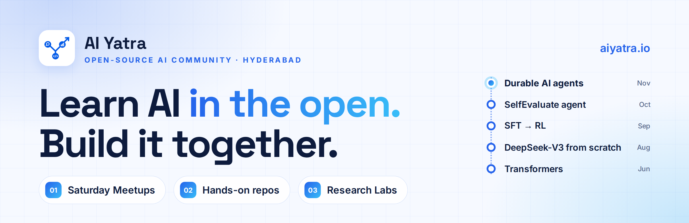

<a href="https://aiyatra.io">
  <picture>
    <source media="(prefers-color-scheme: dark)" srcset="banner-dark.png">
    
  </picture>
</a>

  
  
  
  
  

  <b>8,100+ members</b> on Meetup · <b>18 sessions</b> so far · rated <b>4.7 ★</b> by 180+ attendees

**AI Yatra** is an open-source AI community in Hyderabad. Most Saturdays we pick one idea, from transformers to RL to durable agents, and spend the morning building it together: slides, a live demo, and code that runs on your own laptop. Every session leaves its code here, so you can follow along afterwards.

## 🧪 Build along

Each repo is the code from one session. Clone it, run it, break it.

| Session | Repo | What you build |
|---|---|---|
| **Durable AI Agents** · Nov 2026 | [`durable-ai-agents`](https://github.com/AI-Yatra/durable-ai-agents) | A chai-ordering agent you `kill -9` on purpose: plain, durable (LangGraph) and Temporal. With a [3-part blog series](https://aiyatra.io/blog/beyond-the-harness-part-1-persistent-is-not-durable) and [100 hackathon problems](https://github.com/AI-Yatra/durable-ai-agents/blob/main/hackathon/README.md). |
| **SelfEvaluate Agent** · Oct 2026 | [`selfevaluate-agent`](https://github.com/AI-Yatra/selfevaluate-agent) | Notebooks from first principles to LangChain, LangSmith and LangGraph, building a safe agent step by step. |
| **JEV: Fast, Structured System-1 AI** · Oct 2026 | [`s1ced-playground`](https://github.com/AI-Yatra/s1ced-playground) | A small model that answers questions about text with probabilities. Runs on a laptop, no GPU. |
| **SFT to RL** · Sep 2026 | [`sft-to-rl`](https://github.com/AI-Yatra/sft-to-rl) | Supervised fine-tuning, then reinforcement learning, to train models to think better. |
| **Harnessing Agentic AI** · Sep 2026 | [`yatra-harness`](https://github.com/AI-Yatra/yatra-harness) | A coding-agent harness you can read in an afternoon, with `ay`, a Claude Code-style REPL. |
| **DeepSeek-V3 from scratch** · Aug 2026 | [`deepseek-v3-compact-proxy`](https://github.com/AI-Yatra/deepseek-v3-compact-proxy) | MLA, DeepSeekMoE and multi-token prediction, sized to train on one consumer GPU. |
| **goose, end to end** · Aug 2026 | [`goose-workshop`](https://github.com/AI-Yatra/goose-workshop) | Hands-on with the open-source goose agent, from "what is an agent?" to its dev kit. |

More sessions, slides and recordings: [past events on Meetup](https://www.meetup.com/aiyatra/events/past/).

## 🙌 Get involved

- **Come to a session.** RSVP on [Meetup](https://www.meetup.com/aiyatra/). Sessions are free and in person in Hyderabad.
- **Join the conversation** in the [WhatsApp community](https://chat.whatsapp.com/GWXTDtGjIs99fDtUGKJy5J?mode=gi_t): session links, questions and what people are building.
- **Write for the blog.** Turn what you learned into a post: [write one](https://aiyatra.io/blog/write), or read [the guide](https://aiyatra.io/blog/guide) first.
- **Become a student ambassador** and bring AI Yatra to your campus: [aiyatra.io/ambassadors](https://aiyatra.io/ambassadors).
- **Research Labs.** Go deeper on a topic with a small group: [aiyatra.io/labs](https://aiyatra.io/labs).
- **Improve the website.** [`aiyatra.io`](https://github.com/AI-Yatra/aiyatra.io) is open source, and pull requests are welcome.

## 📬 Say hello

Want to speak, host a session or partner with us? Write to **[global.aiyatra@gmail.com](mailto:global.aiyatra@gmail.com)** or use [aiyatra.io/contact](https://aiyatra.io/contact).

Learn AI in the open. Build it together. · <a href="https://aiyatra.io">aiyatra.io</a>

